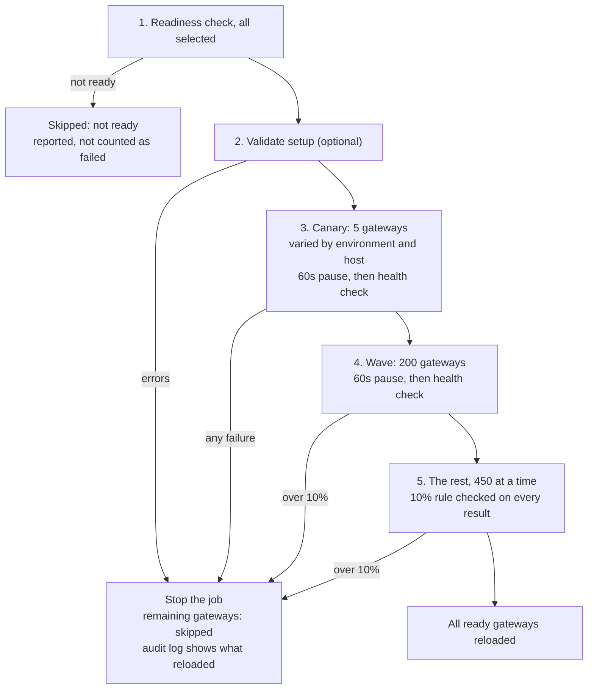

# Geneos Fleet Command API — Design

> Exported 2026-10-15 from the [live design doc](https://claude.ai/artifact/5DvZ2vVi4Nm5sMKLHsrmrq), which remains the source of truth and holds the architecture diagram. Re-export after edits there.

## Summary and goals

We will build a FastAPI service that runs Geneos Gateway REST commands against 1, many or all of our ~1,500 Gateways (never more than 2,000; all 6.9 or newer) in one request, and returns one aggregated, per-gateway result. Today each of these is a manual, one-gateway-at-a-time task.

Goals:

- **One call, many gateways:** run `reloadSetup`, setup validation, entity search and dataview snapshots across a selected set of gateways.
- **Safe by default:** validation before reload, waves with a failure threshold, hard limits on fan-out, an audit trail.
- **Act as the user:** every gateway call uses the caller's own SSO token, so Gateway permissions still apply.
- **Never all-or-nothing:** one slow or broken gateway never fails the whole job.
- **Run on OpenShift** with standard Helm packaging.

## Background: the Gateway REST API

Each Gateway exposes a REST service that takes POST requests with a JSON body; targets are Geneos XPaths in the body, not the URL. The service is **off by default** and must be enabled per gateway under Commands → Advanced → REST service. Nothing in this design works on a gateway until that is done.

Endpoints we use:

| Endpoint | Use in this service | Documented |
| --- | --- | --- |
| `/rest/runCommand` | Run a command on exactly one target, e.g. `/GATEWAY:reloadSetup` on `/geneos/gateway[(@name="GW")]/directory` | Yes |
| `/rest/setup/validate` | Pre-flight validation report | Yes |
| `/rest/snapshot/dataview` | Dataview values, severity, snooze state (one dataview per call) | Yes |
| `/rest/authorize` | Not used: tokens come from the SSO Agent directly | Yes |
| `/rest/gatewayinfo/timezone` | Cheap reachability and auth check | Yes |
| `/rest/xpaths/match` | Resolve an XPath to matching items, with a `limit` (default 100) | No, used by ITRS's cordial library; available on all our gateways |
| `/rest/xpaths/commandTargets` | Items a command can run on (dry run) | No, used by ITRS's cordial library |

Responses carry a `status` of `finished` or `error`, plus interleaved `stdout`, `stderr` and `execLog` streams, which we flatten per gateway. The gateway also offers a server-sent-events stream; v1 uses JSON only.

Sources: [Gateway Commands, REST Service (Geneos 7.11)](https://docs.itrsgroup.com/docs/geneos/7.11.0/processing/monitoring-and-alerts/geneos_commands_tr/index.html) · [ITRS cordial commands.go](https://github.com/itrs-group/cordial/blob/v1.7.0-beta/pkg/commands/commands.go)

## Scope

v1 ships read-only fleet checks first, then reloadSetup, then dataview snapshots. Every feature targets 1, many or all gateways, selected by name, by environment (Dev, UAT, Prod) or primary host, or by `all` (gated for reloads only, see limits).

| Phase | Feature | Gateway calls | Mutates? |
| --- | --- | --- | --- |
| 1 | **Readiness report:** reachable, REST enabled, SSO works, TLS valid and expiry date | `gatewayinfo/timezone` | No |
| 1 | **Fleet validate:** one report of setup errors and warnings | `setup/validate` | No |
| 2 | **Reload setup:** optional validate first, canary then waves, stop on failure threshold | `runCommand` `/GATEWAY:reloadSetup` | Yes |
| 2 | **Managed entity search:** XPath filter, results per gateway | `xpaths/match` | No |
| 3 | **Dataview snapshot:** exact managed entity, sampler and dataview names; aggregated into one payload | `snapshot/dataview` | No |

Later candidates: bulk snooze and unsnooze with mandatory comments, bulk user assignment, an allowlisted generic command runner, "where does entity X live", command inventory across gateways, CSV export, job-complete webhooks.

Non-goals for v1:

- Enabling the REST service itself. That is a setup change delivered through the existing config route; this API cannot reach a gateway until it is done.
- Reloading individual setup or include files. `/GATEWAY:reloadSetup` reloads the whole setup; we are not aware of a per-file reload over REST (open question).
- Wildcard dataview queries.
- Editing gateway setup files.

## Architecture

A request flows down one path: the API validates it, the job service resolves the selector against the cached inventory, and the fan-out executor calls each gateway with bounded concurrency. (Architecture diagram: see the live doc.)

The executor is the one place that controls load on the gateways; everything above it is cheap, and everything below it is network.

Code layout:

```
app/
  main.py                 # app factory; lifespan opens and closes the AsyncClient
  core/config.py          # pydantic-settings
  api/routers/            # readiness, validate, commands, entities, dataviews, jobs
  geneos/client.py        # GatewayClient: run_command, match_xpaths, validate, snapshot, authorize
  geneos/models.py        # Pydantic request and response models
  services/               # fanout, jobs (JobStore interface), inventory, tokens, audit
tests/                    # pytest, pytest-asyncio, respx
fake_gateway/             # FastAPI stand-in for load and contract tests
chart/                    # Helm chart
```

## Key decisions and trade-offs

Each choice below holds until the condition in the last column; the design's breaking point is the single pod, which caps us at two fleet-wide jobs at a time and loses running jobs on restart.

| Decision | Solves | Worsens | Change it when |
| --- | --- | --- | --- |
| Async jobs (202 + poll or SSE) | Full fan-out outlasts the 30s Route timeout; one slow gateway never blocks the caller | Callers must poll; job state to hold and expire | Most calls target 1–5 gateways and finish in seconds → add a synchronous path for small selectors |
| Act as the caller (their SSO token) | Gateway permissions apply unchanged; audit names a real person | Token handling in our pod; each user's 1-day refresh token is held in pod memory | Security review rules out holding refresh tokens in the pod → service account plus our own permission checks |
| One replica, jobs in memory | No database to run; simplest thing that works | Single point of failure; deploys and restarts lose running jobs | Availability target needs 2 replicas, or job history must survive restarts → Oracle as the shared store |
| Pod-wide semaphore (500) plus 1 call per gateway | Bounds load on every gateway and on our pod | A full-fleet job takes 8–15s or more; jobs queue behind each other | Load test shows gateways tolerate more, or jobs routinely wait → raise limits per operation |
| Canary then waves for reloadSetup | A bad setup change stops after 5 gateways, not 2,000 | A full reload takes about 3–9 minutes, not seconds; a fault that misses every canary gateway reaches 200 more | Measured reload times show the pauses dominate → shorter pauses, never zero canary |
| JSON responses, not the gateway's SSE stream | One parsing path; simpler tests | No live per-gateway output during a long command | Commands that run for minutes need live output → consume the gateway stream |

The fleet never exceeds 2,000 gateways, so growth will not force a second replica; an availability target or durable job history would.

## Authentication and transport security

Callers send their own SSO credentials; the service exchanges them at the SSO Agent for an access token and a refresh token, and acts as that user on every gateway call. Gateway command permissions therefore apply as they would in Active Console.

Callers sign in to this service with FastAPI's built-in OAuth2 password flow, which also gives Swagger UI's Authorize button at `/docs`:

- `POST /v1/auth/token` takes `username` and `password` as form fields (`OAuth2PasswordRequestForm`) and returns `{"access_token", "token_type": "bearer", "expires_in"}`.
- That `access_token` is an opaque service session id, not the SSO token. It maps to the caller's SSO tokens in pod memory, so the SSO refresh token never leaves the pod and a session survives each 300s SSO renewal.
- Every other endpoint takes the session as `Authorization: Bearer <session>`, checked by `OAuth2PasswordBearer(tokenUrl="/v1/auth/token")`. Scripts use the same two calls as the button.

Service roles (who may select `all` or run reloads) come from directory groups mapped in `values.yaml`; Gateway permissions still apply on top. Which groups is an open question.

Credential and token handling:

1. Credentials arrive over HTTPS only and are used once, to get an access token (300s) and a refresh token (1 day) from the SSO Agent.
2. Credentials are never logged, never written to the job store, and dropped as soon as the tokens are issued.
3. Both tokens are held in pod memory per user; they are never logged and never go to Redis or a database. One access token works on every gateway.
4. The service renews the access token with the refresh token at about 240s, once per user however many of that user's jobs are running, so a long reload never meets an expired token.
5. If a renewal fails, running jobs stop starting new calls: in-flight calls finish, a reload stops as it would at the 10% rule, and the remaining gateways report `auth_failed`. The caller signs in again.
6. A service session lasts as long as its refresh token, at most 1 day. Signing out or a pod restart drops both tokens.

Transport:

- **HTTPS only, no HTTP fallback.** The insecure port works only if a gateway admin allows it, and we carry SSO tokens.
- Certificates are verified against the internal CA bundle, mounted from a ConfigMap or Secret. `verify=False` is never used.
- A gateway that offers only HTTP, or presents a bad certificate, is reported as `tls_error`, never downgraded.

Confirmed: one token is valid on every gateway that trusts the same SSO Agent, so a job needs one token, not one per gateway. Access tokens last 300s and are renewed with a 1-day refresh token from the SSO Agent. Gateways take it in an Authorization: Bearer header.

## API surface

Every fleet operation is asynchronous: POST returns `202` with a `job_id`, and the caller polls or streams the job. A full fan-out can outlast the OpenShift Route's default 30s timeout, so synchronous calls are not offered.

| Method | Path | Body or purpose |
| --- | --- | --- |
| POST | `/v1/auth/token` | Form fields username and password → {access_token, token_type, expires_in}: a service session, valid up to 1 day |
| DELETE | `/v1/auth/token` | Sign out: drop the caller's access and refresh tokens |
| GET | `/v1/gateways` | Cached inventory and last-known readiness |
| POST | `/v1/readiness` | `{selector}` → job |
| POST | `/v1/setup/validate` | `{selector}` → job |
| POST | `/v1/commands/reload-setup` | `{selector, validate_first, canary_gateways?, max_failure_pct}` → job |
| POST | `/v1/managed-entities/search` | `{selector, xpath_filter, limit}` → job |
| POST | `/v1/dataviews/snapshot` | `{selector, managed_entity, sampler, dataview, probe?, sampler_type?, scope}` → job |
| GET | `/v1/jobs/{id}` | Summary counts plus per-gateway results, paginated |
| GET | `/v1/jobs/{id}/events` | Server-sent events progress |
| GET | `/v1/jobs/{id}/results` | NDJSON stream of every per-gateway result |
| POST | `/v1/jobs/{id}/cancel` | Stop dispatching new gateway calls; in-flight calls finish and the rest report skipped |

`selector` is one of three forms:

- **By name:** `{"gateways": ["GW1", "GW2"]}`.
- **By inventory filter:** `{"environment": "UAT", "hosts": ["host1", "host2"]}`, matching the inventory's environment (Dev, UAT, Prod) and primary host. Give either field or both; both must match.
- **Everything:** `{"all": true}`.

An empty selector is rejected, so a blank request can never mean "all". The service turns every selector into a gateway list before any call, and the job records that list.

Mutating requests (`reload-setup`) require an `Idempotency-Key` header, kept for 24h: a retried POST returns the original `job_id` instead of starting a second fleet reload. A reload whose gateways overlap a running reload is rejected with `409 Conflict`. Throttled requests get `429` with `Retry-After`, and every error uses one envelope: `{code, message, request_id, retryable}`.

The service builds each gateway's XPath itself. Callers supply only the part after `/directory`; for example `/probe/managedEntity[(attr("Env")="PROD")]` becomes `/geneos/gateway[(@name="GW1")]/directory/probe/managedEntity[(attr("Env")="PROD")]`.

Each per-gateway result has the same shape:

```json
{
  "gateway": "GW1",
  "status": "ok",
  "duration_ms": 840,
  "data": {},
  "error": null
}
```

`status` is one of `ok`, `error`, `not_found`, `ambiguous_target`, `timeout`, `auth_failed`, `tls_error`, `rest_disabled`, `unreachable` or `skipped` (validation failed, or the wave stopped).

For `reloadSetup`, `timeout` means the outcome is unknown: the reload may have run. Mutating calls are never retried automatically. Read-only calls retry once on a connection error, after a jittered delay.

## Concurrency, load and abuse limits

The work is network-bound, so one replica (1 vCPU, 1.5 GiB) should handle a full 2,000-gateway fan-out; gateway load, not our pod, is the real risk. These are estimates until the load test in Testing and rollout.

Estimate: 1,500 TLS handshakes cost a few seconds of CPU in total. At 500 concurrent calls and about 2s per call, a full 2,000-gateway job takes about 8–15s. `reloadSetup` on large setups is slower, and the gateways set that pace.

Fan-out mechanics:

- One shared `httpx.AsyncClient` per pod with connection pooling; a pod-wide `asyncio.Semaphore` caps concurrent gateway calls (default 500).
- Per-gateway connect and read timeouts; each call turns its own exceptions into a result, so `asyncio.gather` never fails the job.
- Each inventory entry holds primary and secondary hosts for hot-standby pairs. Every call goes to the active member only. The inventory does not say which host is active, so we call the primary first; if it is unreachable or answers as the standby, we try the secondary once within the same per-gateway deadline, and remember which host answered for later jobs.

Limits, in order of importance:

| Limit | Default | Why |
| --- | --- | --- |
| Exact names only for dataview snapshots | No wildcards | Bounds a snapshot to one call per gateway |
| Gateways per reload request | 200 without the admin role; more, including `all` or a whole environment, needs it | Stops one reload hitting the whole estate by accident. Read-only operations have no cap, and any user may select all |
| In-flight calls per gateway, across all users | 1 | Protects gateways from us |
| Concurrent jobs per user | 5 | Fair share between users |
| Job submissions per user | 30 per minute | Stops scripted hammering; job reads have a separate, looser limit so polling a job is never throttled |
| Snapshot result cache | 15s, keyed on user, gateway and target | A refreshing view costs one gateway call per 15s; keying on user means no one sees data fetched with someone else's token |
| Response size | Capped, paginated beyond it | Search results can reach hundreds of MB |
| Reload waves | Canary of 5, spread across environments and hosts, must all succeed; then a wave of 200, then the rest in batches of 450. A 60s pause and health check follow the canary and the wave of 200. Stop as soon as failures exceed 10% of gateways attempted | A bad setup change halts early; gateways that fail readiness are skipped before the canary, so known outages do not trip the threshold |
| Gateway-call slots per job | 250 of the pod's 500; a reload may use 450, keeping 50 for reads | One full-fleet read cannot starve everyone else's small jobs. Reloads are rare and admin-only, so they take up to 450 and other jobs share the 50 left; each gateway still gets one call at a time |
| Running jobs per pod | 10; more are rejected with 429 | Bounds memory: one large search can need ~400 MB of a 1.5 GiB pod |
| Finished-job retention | 24h or the last 500 jobs, whichever is smaller | In-memory results cannot grow without bound |

Memory is the first limit we hit, not CPU: 2,000 gateways × 1,000 XPaths each is about 400 MB. Large results are streamed as NDJSON or paginated, never held as one blob.

## Reload rollout

A reload reaches the fleet in growing steps, so a bad setup change stops after 5 gateways, not 2,000.



- **Readiness first.** Gateways that are already unreachable are reported as skipped before any reload, so an existing outage cannot trip the stop rule.
- **A varied canary.** The 5 canary gateways are spread across the environments (Dev, UAT, Prod) and primary hosts in the selection, so a fault tied to one environment or host shows up early. Callers can name them instead with `canary_gateways`. All 5 must reload and pass the health check; one failure stops the job.
- **Wave of 200.** Catches faults that hit only some gateways and missed all 5 canaries.
- **Pause and health check.** After the canary and the wave of 200 we wait 60s, then make a readiness call to each gateway just reloaded. A reload can report `finished` and still leave a gateway broken; the pause lets that show.
- **The rest, 450 at a time.** No pause. A reload may use 450 of the pod's 500 slots, so 50 always stay free for read-only jobs; each gateway still gets one call at a time.
- **The 10% rule, checked on every result.** Once failures pass 10% of gateways attempted, no new calls start; calls already running finish and the rest are skipped. Batches of 450, not all at once, keep this rule useful: it only protects gateways that have not started.

Named canaries (`canary_gateways`) are checked before any reload:

- **Inside the selection.** A canary outside the gateways being reloaded is rejected with `400`, so it can never reload a gateway the caller did not select.
- **Ready.** A named canary that fails the readiness check rejects the job; the service never swaps in another gateway, because the caller chose those for a reason.
- **1 to 20 gateways.** At least one, so no reload skips the canary; at most 20, so the canary stays small.
- **Same stop rule.** Any failure among named canaries stops the job, as with the automatic ones.

Estimated time for 2,000 gateways, by how long one reload takes:

| Reload time per gateway | Estimated total |
| --- | --- |
| 5s | ~3 min |
| 30s | ~5.5 min |
| 60s | ~8.5 min |

That is about 2.3 minutes of fixed time (readiness check and two pauses) plus 6 rounds of reload time; validate-first adds 30–60s. The spike in rollout step 1 measures the real reload time.

## Job state and persistence

v1 keeps jobs in memory on a single replica, behind a `JobStore` interface, so a shared store can be added later without touching the rest of the code.

In-memory is acceptable while all of these hold:

- One replica, one uvicorn worker.
- Losing in-flight jobs on a pod restart is acceptable; the caller re-runs them, and `reloadSetup` is safe to repeat. A restart mid-reload loses wave progress, so the re-run starts again from the canary.
- Large results are streamed or paginated, not held whole.

v1 needs no database. We add a shared store only when one of these becomes true:

- Two replicas for availability, because `GET /jobs/{id}` may land on the pod that does not hold the job.
- Jobs must survive restarts and deploys. (Audit history already does, through log aggregation.)
- Two jobs must be prevented from hitting the same gateway across replicas.

If that happens, the store is the Oracle database we already run. Jobs, idempotency keys and per-gateway leases are a few small rows per job at a handful of jobs a minute, well within what Oracle handles, and a row lock (`SELECT … FOR UPDATE SKIP LOCKED`) is enough to stop two replicas calling the same gateway at once.

Redis is needed in one case only: service sessions shared between replicas. SSO tokens are never written to Oracle, so with two replicas either sessions live in Redis, encrypted, or a caller whose request lands on the other pod signs in again. Until there are two replicas, neither applies.

Sticky sessions on the Route are not a substitute; they break on pod restarts.

On shutdown (SIGTERM) the pod stops accepting jobs, lets read-only jobs finish, and stops reload jobs at the end of the current wave, all within the 300s grace period. The audit log then shows exactly which gateways were reloaded.

What stays per-pod regardless: the SSO token cache and the inventory cache.

**Inventory** comes from the existing inventory API, which gives each gateway's name, environment (Dev, UAT, Prod) and primary and secondary hosts. It is cached for about 15 minutes, served stale while refreshing, force-refreshed when a gateway is missing or a connection fails, and the last good copy is kept if the inventory API is down.

**Audit log:** every call records who ran what, against which gateways, when, and the outcome. It is written to stdout as structured JSON, which the platform ships to log aggregation automatically; that aggregated log is the durable audit record, so v1 needs no store of its own for it.

## Failure modes and degradation

Every dependency failure ends as a per-gateway status or a clear job-level error; none silently drops gateways from a result.

| Failure | What the service does | What the caller sees |
| --- | --- | --- |
| One gateway slow or down | Per-call timeout; read-only calls retry once with jitter | That gateway as `timeout` or `unreachable`; the rest of the job completes |
| Many gateways down (network event) | Calls fail fast on connect timeout; a reload stops at the failure threshold | Job finishes early with most gateways `unreachable`; reload reports `skipped` for the rest |
| SSO Agent down | Sign-in fails: the job is rejected before any gateway call. A renewal fails mid-job: no new calls start | `503` with `retryable: true`, not 1,500 `auth_failed` rows |
| Inventory API down | Serve the last good copy, flagged with its age | Results carry `inventory_as_of`; unknown names are `not_found` |
| Pod restart or deploy | Drain on SIGTERM; reloads stop at a wave boundary | Running jobs are lost after the grace period; `GET /jobs/{id}` returns `404` and the caller re-runs |
| Reload call times out | Never retried; counted as a failure toward the threshold | `timeout` with outcome unknown; check the gateway before re-running |
| Pod out of memory | Per-job and per-pod caps, streamed results | Excess jobs get `429`; a crash loses running jobs as above |

## Deployment on OpenShift

The service ships as a Helm chart in the standard layout, with Python 3.11+ managed by `uv`.

| Concern | Choice |
| --- | --- |
| Exposure | OpenShift `Route` with edge or re-encrypt TLS; Route timeout raised for SSE streams |
| Security context | Restricted SCC: non-root, random UID, no privilege escalation, read-only root filesystem |
| Resources | Starting point: requests 500m CPU / 512Mi, limits 1 CPU / 1.5Gi; tuned after the load test |
| Probes | `livenessProbe` on `/healthz`; `readinessProbe` on `/readyz`, ready once the inventory cache is warm or a persisted last-good inventory is loaded, so an inventory outage at start-up cannot keep the only pod down |
| Config | All settings in `values.yaml` → ConfigMap: limits, timeouts, inventory URL, wave sizes |
| Secrets | CA bundle and any service credentials from Secrets; no secrets in templates |
| Image | `.Values.image.repository` and `.Values.image.tag` |
| Namespace | Always `{{ .Release.Namespace }}`, never hardcoded |
| Replicas | 1 in v1; 2+ only with a shared job store. Recreate strategy, so two pods never hold jobs at once; 300s termination grace period to drain |
| Egress | NetworkPolicy allowing the gateway port ranges and the inventory API only |

`templates/NOTES.txt` gives the Route URL, the health endpoints and a sample readiness call. File-descriptor limits and any egress proxy or firewall rules on the gateway ports need checking with the platform team before the first full-fleet run.

## Observability

We page on one symptom: jobs failing for reasons inside our service. Gateway-side failures are reported to callers, not paged.

- **Service metrics (RED):** request rate, error rate by status class, and p95/p99 latency per endpoint.
- **Job metrics:** jobs started and finished by operation and outcome, job duration, per-gateway results by `status` (no gateway-name label, to keep series bounded), reloads stopped by the threshold.
- **Saturation (USE):** semaphore slots in use, jobs waiting for a slot, pod memory, inventory age.
- **Alerts:** page when more than 5% of jobs fail with a service-side error over 15 minutes, or the pod restarts during a reload. Ticket when inventory is older than 1h or memory passes 80%.
- **Tracing:** a `request_id` on every log line and audit record, tying a job to each gateway call it made.

The SLO (proposed, not agreed): 99% of jobs complete without a service-side error, over 30 days.

## Testing and rollout

We prove the plumbing read-only on a handful of gateways before any mutating command reaches production.

Testing:

- **Unit and API tests** with `pytest` and `pytest-asyncio`; gateway HTTP mocked with `respx`, covering every result status.
- **Fake gateway service:** a small FastAPI app that mimics the REST responses, with configurable latency, errors and TLS behaviour.
- **Load test** against 2,000 fake gateway endpoints, to set real concurrency, memory and CPU limits.
- **Failure tests:** kill the pod mid-wave, stop the fake SSO Agent and inventory API, expire an access token mid-reload, and retry a reload POST with the same key; each must match the failure table above.

Rollout:

1. Spike on one real gateway: confirm what a REST-disabled gateway returns, and how long reloadSetup takes on a small and a large setup.
2. Ship the readiness report and fleet validate; run readiness across the estate to get the list of gateways still needing REST enabled.
3. Enable REST on the remaining gateways through the normal config route, tracked from the readiness report.
4. Ship reloadSetup against a non-production group, then production with canary and waves.
5. Ship managed entity search and dataview snapshots.

## Open questions and risks

The first three change the build, and each can be settled by testing one gateway.

- [x] **SSO token scope:** one access token works on every gateway trusting the same SSO Agent, lasts 300s, and is renewed with a 1-day refresh token from the SSO Agent and is sent to gateways as Authorization: Bearer (confirmed).
- [x] **XPath match on 6.9:** does `/rest/xpaths/match` respond on our oldest gateways? Yes, available on all our gateways, though it is not in the public docs.
- [ ] **REST disabled:** what does a gateway return when REST is off (404, connection refused, something else)?
- [ ] **Per-file reload:** what does "reload 1, many or all files" mean, and is there a REST command for it? As far as we know, reloadSetup reloads the whole setup.
- [ ] **Shared store:** Oracle is available and Redis may be; v1 needs neither (see Job state and persistence). Is a single replica acceptable to start?
- [ ] **REST coverage:** how many gateways already have REST enabled?
- [ ] **Usage and availability:** how many users and jobs per day, and does anyone need the service during a deploy? This decides whether one replica is enough.
- [ ] **Service roles:** which directory groups may select all gateways or run reloads?
- [ ] **Hot standby:** what does a standby gateway return to a REST call, so we can tell it apart from an outage, and does reloadSetup on the active gateway reach its standby?

Risks:

| Risk | Mitigation |
| --- | --- |
| A bad setup change reloaded across the fleet | Validate first, canary, waves, stop at failure threshold, audit log |
| The service overloads gateways | 1 in-flight call per gateway, per-request gateway cap, snapshot cache |
| Credentials or tokens leak | Memory only, never logged or persisted, HTTPS only; credentials dropped after sign-in, tokens dropped on sign-out |
| Large search results exhaust pod memory | Streaming NDJSON, pagination, size cap |
| Undocumented endpoints change in a Gateway upgrade | Isolated in `GatewayClient`, covered by contract tests on each Gateway version in use |
| A retried request or a second user starts an overlapping reload | Idempotency-Key on reload requests; 409 for overlapping reloads |
| Pod restart or deploy mid-reload | Drain to the end of the wave, Recreate strategy, audit log of each gateway reloaded |
| One full-fleet job starves other users | Per-job cap of 250 call slots out of the pod's 500 |
